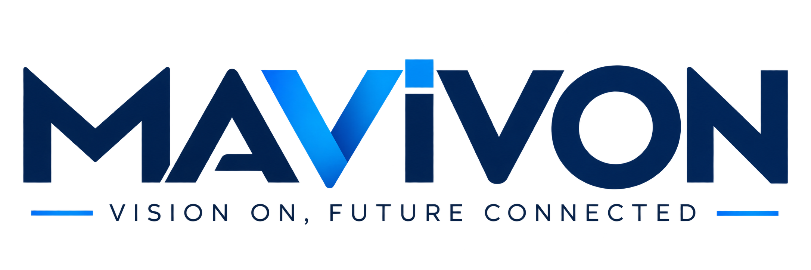

# MAVIVON Teknoloji | Fiber Optik, GPON, Cat6 ve CCTV Egitim Kutuphanesi

Fiber optik altyapi kurarken dogru urunu secmek kadar, o urunun neden secildigini bilmek de gerekiyor. Bu kutuphanede MAVIVON Teknoloji olarak hazirladigimiz 14 Turkce egitim kilavuzunu bir araya getirdik. Kilavuzlar; uretim ve malzemeden proje planlamaya, montajdan olcum ve teslime kadar uygulamada karsilasilan sorulari ele aliyor.

**Resmi web sitesi: [www.mavivon.com.tr](https://www.mavivon.com.tr)**

Saha ekipleri, proje muhendisleri, sartname hazirlayanlar, satin alma birimleri, universiteler ve konuyu ogrenmek isteyenler yayinlari asagidaki baglantilardan ucretsiz inceleyebilir.

## PDF yayin dizini

Tablodaki tarihler kilavuzlarda belirtilen yayin tarihleridir. GitHub'a yukleme ve degisiklik tarihleri deponun kayitlarinda ayrica gorunur.

| No | Kilavuz ve PDF baglantisi | Yayin tarihi | Kapsam |
|---|---|---|---|
| 01 | [Fiber Optik Splitter](MAVIVON_Fiberoptik_Splitter_Kilavuzu.pdf) | 20/12/2023 | PLC ve FBT yapilari, bolme orani, optik butce, uretim, montaj ve test. |
| 02 | [Fiber Optic Splice Closure ve FTTH Box](MAVIVON_Fiber_Optic_Splice_Closure_FTTH_Box.pdf) | 14/02/2024 | Ek ve dagitim kutularinda malzeme, kablo girisi, sizdirmazlik ve fiber yonetimi. |
| 03 | [Yer Alti Fiber Optik Kablolar](MAVIVON_Underground_Fiber_Optic_Cable_Kilavuzu.pdf) | 08/05/2024 | Kablo kesitleri, uretim, zirh ve kilif secimi; kanal ici cekim ve dogrudan gomme. |
| 04 | [Fiber Optik Drop Cable](MAVIVON_Drop_Cable_Egitim_Kilavuzu.pdf) | 24/09/2024 | Flat, round ve self-supporting yapilar; aski teli, abone guzergahi ve sonlandirma. |
| 05 | [FTTH Box: Bina ve Abone Dagitimi](MAVIVON_FTTH_Box_Bina_ve_Abone_Dagitimi.pdf) | 03/03/2025 | Bina girisinden aboneye dagitim, kutu kapasitesi, port duzeni ve montaj. |
| 06 | [Fiber Optik Patch Cord](MAVIVON_Patch_Cord_Egitim_Kilavuzu.pdf) | 18/09/2025 | Fiber ve konektor secimi, UPC/APC, uretim asamalari, temizlik ve olcum. |
| 07 | [Fiber Optik Fast Connector](MAVIVON_Fast_Connector_Egitim_Kilavuzu.pdf) | 11/12/2025 | Field assembly connector secimi, fiber hazirligi, kesim, saha montaji ve kontrol. |
| 08 | [Fiber Optik Pigtail](MAVIVON_Pigtail_Egitim_Kilavuzu.pdf) | 22/01/2026 | Pigtail yapisi, fiber ve buffer uyumu, fusion splice, panel duzeni ve test. |
| 09 | [Fiber Optik Altyapi](MAVIVON_Fiberoptik_Altyapi_Egitim_Kilavuzu.pdf) | 07/03/2026 | Kesif, guzergah, kablo montaji, ek planlama, olcum ve teslim sureci. |
| 10 | [CCTV Kamera Secimi, Projelendirme ve Yapay Zeka](MAVIVON_CCTV_Kamera_Projelendirme_Yapay_Zeka.pdf) | 19/03/2026 | Lens, gorus alani, aydinlatma, kamera secimi, video analytics ve yapay zeka. |
| 11 | [CCTV Kayit Cihazlari](MAVIVON_CCTV_Kayit_Cihazlari.pdf) | 22/04/2026 | NVR/DVR secimi, veri hizi, disk kapasitesi, saklama suresi ve sistem uyumu. |
| 12 | [Cat6 Kablolar](MAVIVON_Cat6_Kablo_Egitim_Kilavuzu.pdf) | 05/05/2026 | Iletken, bukum, ekranlama, kilif, frekans, PoE, uretim ve sartname hazirligi. |
| 13 | [Cat6 Patch Panel ve Aksesuarlar](MAVIVON_Cat6_Patch_Panel_Aksesuarlar.pdf) | 19/07/2026 | Keystone, IDC sonlandirma, ekranlama, rack duzeni, etiketleme ve test. |
| 14 | [GPON Altyapi Planlama](Mavivon_Gpon_Altyap%C4%B1_Planlama.pdf) | 15/09/2026 | OLT, ONT ve splitter yerlesimi; optik guc butcesi, kapasite ve proje ornekleri. |

## Hangi kilavuzdan baslamali?

- **Fiber optik projeye yeni baslayanlar:** Fiber Optik Altyapi ve GPON Altyapi Planlama.
- **FTTH saha uygulamalari:** Drop Cable, Splice Closure, FTTH Box, Fast Connector ve Pigtail.
- **Urun secimi ve satin alma:** Splitter, Patch Cord, Yer Alti Kablolar ve Cat6 Kablolar.
- **Bina ici yapisal kablolama:** Cat6 Kablolar ile Cat6 Patch Panel ve Aksesuarlar.
- **Guvenlik kamera projeleri:** CCTV Kamera Secimi, Projelendirme ve Yapay Zeka ile CCTV Kayit Cihazlari.

Bir PDF'yi acmak icin basligina tiklayin. GitHub onizlemesi yuklenmezse dosya sayfasindaki **Download raw file** secenegini kullanabilirsiniz. Dokumanlarin kendi kapaklari, cizimleri, urun ornekleri ve kapanis sayfalari korunmustur.

## Kullanim ve teknik degerlendirme

Yayinlar egitim ve urun secimine destek amaciyla hazirlanmistir. Projeye uygulanacak degerler, guncel urun veri sayfalari, cihaz sinirlari, ilgili standartlar ve saha kosullariyla birlikte degerlendirilmelidir. Urun ornekleri ve kavramsal cizimler, ilgili kilavuzun aciklamalariyla okunmalidir.

## MAVIVON Teknoloji

**MAVIVON TEKNOLOJI IC ve DIS TICARET ANONIM SIRKETI**

Sepetlipinar Mahallesi, Zafer Caddesi No: 15, Basiskele / Kocaeli

- Web: [www.mavivon.com.tr](https://www.mavivon.com.tr)
- E-posta: [sales@mavivon.com.tr](mailto:sales@mavivon.com.tr)
- Telefon: +90 262 606 0002

Teknik egitim yayinlari hakkindaki goruslerinizi ve proje ihtiyaclarinizi bizimle paylasabilirsiniz.

## Yayinlarin detay sayfalari

- [01 — Fiber Optik Splitter](01-mavivon_fiberoptik_splitter_kilavuzu.md)
- [02 — Fiber Optic Splice Closure ve FTTH Box](02-mavivon_fiber_optic_splice_closure_ftth_box.md)
- [03 — Yer Alti Fiber Optik Kablolar](03-mavivon_underground_fiber_optic_cable_kilavuzu.md)
- [04 — Fiber Optik Drop Cable](04-mavivon_drop_cable_egitim_kilavuzu.md)
- [05 — FTTH Box: Bina ve Abone Dagitimi](05-mavivon_ftth_box_bina_ve_abone_dagitimi.md)
- [06 — Fiber Optik Patch Cord](06-mavivon_patch_cord_egitim_kilavuzu.md)
- [07 — Fiber Optik Fast Connector](07-mavivon_fast_connector_egitim_kilavuzu.md)
- [08 — Fiber Optik Pigtail](08-mavivon_pigtail_egitim_kilavuzu.md)
- [09 — Fiber Optik Altyapi](09-mavivon_fiberoptik_altyapi_egitim_kilavuzu.md)
- [10 — CCTV Kamera Secimi, Projelendirme ve Yapay Zeka](10-mavivon_cctv_kamera_projelendirme_yapay_zeka.md)
- [11 — CCTV Kayit Cihazlari](11-mavivon_cctv_kayit_cihazlari.md)
- [12 — Cat6 Kablolar](12-mavivon_cat6_kablo_egitim_kilavuzu.md)
- [13 — Cat6 Patch Panel ve Aksesuarlar](13-mavivon_cat6_patch_panel_aksesuarlar.md)
- [14 — GPON Altyapi Planlama](14-mavivon_gpon_altyapi_planlama.md)
